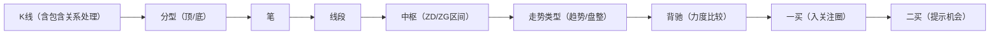
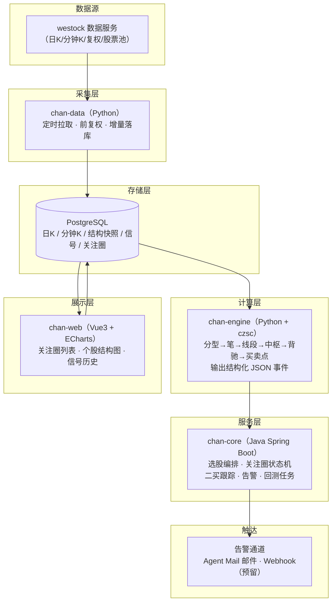
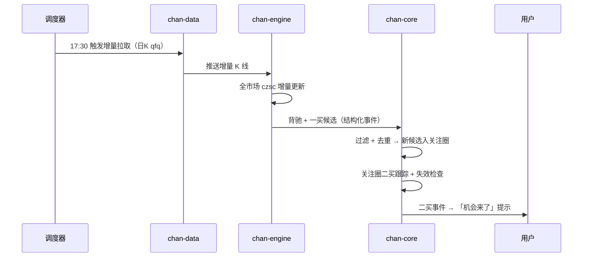
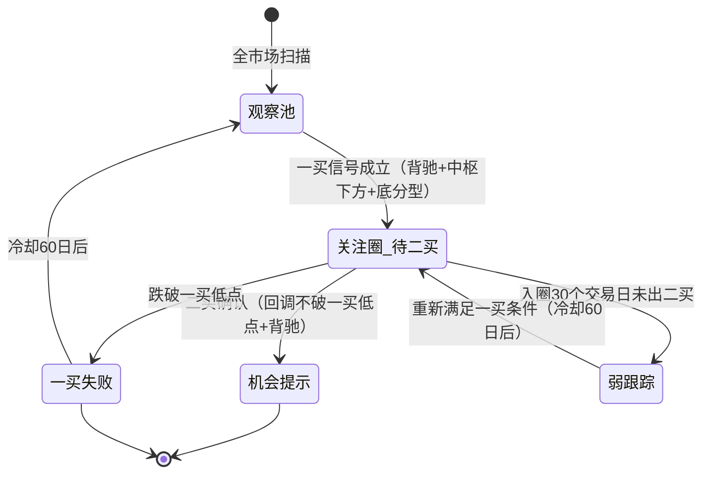

# 缠论 A 股选股与二买跟踪系统 · 立项方案

| 文档信息 | |
|---|---|
| 项目名称 | 缠论 A 股选股与二买跟踪系统（暂定名 ChanPicker） |
| 版本 | v1.0（待评审） |
| 日期 | 2026-10-15 |
| 状态 | 待用户评审确认 |

---

## 1. 项目概述

### 1.1 背景

基于缠中说禅技术分析理论（缠论）构建 A 股量化选股系统：以「**背驰 + 一买**」作为选股入口，将候选股纳入**关注圈**，逐日持续跟踪，直到「**二买**」出现时提示机会。

### 1.2 目标

- **主目标**：日线级别自动识别「趋势背驰 + 一买」候选股 → 入关注圈 → 持续跟踪 → 「二买」确认时推送提示（机会来了）。
- **副目标**：沉淀缠论结构化数据（分型 / 笔 / 线段 / 中枢 / 背驰），支撑历史回测与后续扩展（三买、卖点体系、多级别联立）。

### 1.3 范围界定

**本期做（In Scope）**

- A 股全市场日线级别缠论结构计算（分型 → 笔 → 线段 → 中枢 → 走势类型）
- 背驰检测（趋势背驰为主，盘整背驰为辅）
- 一买信号 → 关注圈建立与管理（含去重）
- 二买跟踪与「机会来了」提示
- 一买失效管理（跌破一买低点出圈）
- 可视化看板（结构图 + 关注圈列表）与历史回测报告

**本期不做（Out of Scope，预留二期）**

- 30 分钟 / 5 分钟级别联立（区间套精定位）——受分钟数据历史长度限制，见 §4.2
- 三买系统化、三类卖点体系化交易
- 自动下单 / 实盘交易
- 仓位与资金管理策略

---

## 2. 缠论方法论与工程化映射

### 2.1 概念链路



### 2.2 核心概念的工程定义

| 概念 | 缠论定义 | 工程实现要点 |
|---|---|---|
| K线包含处理 | 高低点存在包含关系的相邻 K 线合并为非独立 K 线（向上取高高/高低，向下取低高/低低） | czsc 内置，直接用 |
| 分型 | 连续 3 根 K 线，中间 K 线高点为三者最高且低点亦最高 → 顶分型；底分型对称 | czsc 分型识别，输出顶/底分型序列 |
| 笔 | 相邻顶/底分型连接；两分型之间（不含分型）至少 1 根独立 K 线（合计 ≥5 根）；顶底交替 | czsc 笔序列（bi_list），增量更新 |
| 线段 | 至少 3 笔构成，特征序列分型划分 | czsc 线段序列（xd_list） |
| 中枢 | 连续三段次级别走势的重叠区间 [ZD, ZG]，ZD=三段低点最大值，ZG=三段高点最小值 | czsc ZS 对象（现有引擎已有 `_check_zhongshu` 先例） |
| 走势类型 | 趋势=至少两个同向且不重叠的中枢；盘整=单一中枢 | 由笔/段+中枢推导 |
| 背驰 | 同向相邻两段（进入中枢段 vs 离开中枢段）力度比较，离开段衰竭即背驰 | 量化定义见 2.3 |
| 一买 | 下跌趋势最后一个中枢下方 + 趋势背驰 + 底分型确认 | 选股入口信号 |
| 二买 | 一买后第一次回调不破一买低点（次级别背驰更佳） | 提示信号（核心） |
| 三买 | 上涨中回调不进入最后中枢（不破 ZG） | 二期 |

### 2.3 背驰的量化定义（工程口径）

背驰是缠论最核心也最依赖主观判断的环节，必须固化为确定性规则：

- **主判据**：MACD 柱面积比较——取「进入最后中枢的段」与「离开最后中枢的段」各自的 MACD（DIF）柱面积之和，离开段面积小于进入段面积即判背驰。
- **背驰度（用于排序与分档）**：

  ```
  背驰度 = (进入段MACD柱面积 − 离开段MACD柱面积) / 进入段MACD柱面积
  ```

  背驰度 > 0 视为背驰；按分位数划分弱 / 中 / 强三档，用于关注圈内优先级排序。
- **辅判据**（交叉验证，避免单一指标误判）：段内价格变化速度、均线（如 10/20 日均线）面积、段内量能变化。
- **判定时点**：以「确认日」为准——信号在当日 K 线收盘后计算并固化存档，**不复核改判历史信号**（杜绝未来函数）。

### 2.4 信号取舍：一买是入场券，二买是扳机

- **一买**位置最低，但缠论明确指出背驰后可以走「中枢扩展」再下，一买失败率天然偏高 → 本项目一买**只作为入圈条件，不作为交易提示**。
- **二买**确认了「一买有效 + 回调不创新低」，风险收益比优于一买 → **二买才是「机会来了」提示的触发条件**。
- 卖点本期仅用于风控出圈（一买后出现顶背驰破位 → 出圈），不做系统性做空/卖出提示。

### 2.5 级别策略

- **一期**：日线单级别闭环。理由：日 K 全历史可得，信号可完整回测验证；分钟级历史数据受限（见 §4.2）。
- **二期**：日线定方向 + 30 分钟精定位（区间套：日线背驰 → 30 分钟背驰 → 精确买点）。需在上线后持续积累分钟数据，或二期扩展分钟数据源。

---

## 3. 系统总体架构

### 3.1 架构图



### 3.2 模块清单

| 模块 | 职责 | 技术 |
|---|---|---|
| chan-data | 采集调度、前复权处理、增量更新、数据质量校验 | Python |
| chan-engine | 缠论结构计算、背驰量化、一买/二买识别，输出结构化事件 JSON | Python + czsc |
| chan-core | 全市场扫描编排、关注圈状态机、二买跟踪、告警分发、回测任务 | Java + Spring Boot |
| chan-web | 看板：关注圈列表、个股结构图（分型/笔/线段/中枢/背驰/买卖点标注）、信号历史 | Vue3 + ECharts |

### 3.3 每日盘后批处理主流程



### 3.4 关注圈状态机



---

## 4. 数据层设计

### 4.1 数据源能力（已核实）

来源：腾讯自选股 westock 数据 CLI（本环境已随项目配备）。

| 能力 | 命令/参数 | 说明 |
|---|---|---|
| 日 K 全历史 | `westock kline <code> --period day --start ... --end ...` | 支持日期区间，默认单次上限 2000 条 |
| 前复权 | `--fq qfq`（另支持 hfq/bfq，默认不复权） | A 股个股支持，**复权是结构计算正确性的前提** |
| 分钟 K | `--period m1/m5/m15/m30/m60/m120` | 分钟级，见 4.2 限制 |
| 股票池 | `westock sector constituent` / `index constituent` | 板块/指数成份股 |
| 原始 OHLCV | kline 返回序列 | 背驰面积等需基于原始序列自行计算 |

### 4.2 数据限制与对策（关键设计约束）

| 限制 | 影响 | 对策 |
|---|---|---|
| 分钟数据仅保留近 1 个月；m30 单次区间跨度上限 30 天 | 无法获取 30 分钟级长历史，多级别联立无法完整回测 | **一期纯日线闭环**；上线后每日增量积累分钟数据；级别联立列二期 |
| CLI 输出为面向阅读的结构化文本 | 程序化入库需确认机器可读模式 | M1 首日验证输出模式；不可行则降级备选数据源（akshare/tushare） |

### 4.3 存储设计（PostgreSQL）

| 表 | 内容 | 量级估算 |
|---|---|---|
| stock_info | 代码/名称/市场/上市日期/ST 标记 | ~5 千行 |
| kline_day | 日 K（qfq）：OHLCV + amount | 全 A 约 5000+ 只 × 250 日/年 × 10 年 ≈ 千万行级（按年分区） |
| kline_min30 | 30 分钟 K（上线后增量积累） | 上线 6 个月后约百万行级 |
| chan_structure | 缠论结构快照（分型/笔/线段/中枢 JSONB）+ czsc 版本号 | 每日每股票 1 行 |
| signal_first_buy | 一买信号事件：日期/价位/背驰度/中枢区间/结构快照 | 按信号量 |
| watchlist | 关注圈：入圈日/一买信号 ID/状态/出圈日/出圈原因 | 按信号量 |
| signal_second_buy | 二买信号事件 + 关键价位 | 按信号量 |
| alert_log | 告警记录（内容/通道/触达状态） | 按信号量 |

**结构快照全量存档**：每笔信号附带当时的完整结构（分型/笔/线段/中枢）与 czsc 版本号，保证信号可复现、可审计——这是应对「缠论实现歧义」的核心手段（见 §8.1）。

---

## 5. 选股与跟踪逻辑

### 5.1 一买候选条件（日线，全部满足）

1. **结构前提**：近期构成下跌趋势（≥2 个下移中枢），或 czsc 一买信号判定成立；
2. **背驰确认**：最后离开段 vs 进入段 MACD 柱面积背驰（背驰度 > 0）；
3. **价格位置**：背驰低点位于最后一个中枢 ZD 下方（中枢下方背驰，排除中枢内噪音）；
4. **K 线确认**：出现底分型，且其后 K 线未破坏该底分型；
5. **股票池过滤**：非 ST、上市 ≥250 个交易日、近 20 日日均成交额 ≥5000 万元、非停牌。

### 5.2 入关注圈

- 满足 5.1 即入「关注圈-待二买」，记录：一买信号日 / 信号价 / 背驰度 / 结构快照。
- 去重：同一股票 60 日内重复触发一买信号不重复入圈。

### 5.3 二买判定（跟踪核心，全部满足）

1. 一买后出现明确向上笔/段（价格脱离一买区域）；
2. 第一次回调低点 **高于一买低点**（不创新低）；
3. 回调段相对其上涨段力度衰减（背驰；一期用日线近似，二期 30 分钟精确确认）；
4. 出现底分型确认 → **二买成立 → 触发「机会来了」提示**。

- 简化口径（可配置开关）：条件 3 可降级为「回调至一买后上升段的 0.5–0.618 区域出现底分型」，用于一期快速验证。
- 提示内容：股票名称/代码、级别、信号类型、关键价位（一买低点 / 二买区域 / 止损参考位）、信号时间、结构摘要。

### 5.4 失效与降级

| 情形 | 处理 |
|---|---|
| 一买后跌破一买低点 | 标记「一买失败」，出圈（留档复盘） |
| 入圈 30 个交易日未形成二买 | 降级「弱跟踪」，改为周度检查 |
| 跟踪期内出现一卖信号（顶背驰破位） | 提前出圈 |
| 出圈股票 | 冷却 60 日后可重新入圈 |

---

## 6. 技术选型

| 方案 | 描述 | 评价 |
|---|---|---|
| **A（推荐）** | Python 缠论引擎（czsc）+ Java 业务服务（Spring Boot）+ PostgreSQL + Vue3 | 缠论算法直接复用 czsc 生产级开源实现（本环境已有验证可用的 `chan_theory.py` 先例）；Java 侧发挥既有工程栈优势（状态机、告警、运维） |
| B | 全 Python（FastAPI + PostgreSQL） | 轻量，但与既有 Java 技术栈割裂，运维双栈 |
| C | 全 Java 自研缠论算法 | 缠论无成熟 Java 生态，算法质量与工期风险高，不推荐 |

**部署**：Docker + Jenkins + PostgreSQL + Nginx，复用现有 CI/CD 能力。

---

## 7. 项目计划与里程碑

| 里程碑 | 内容 | 产出 | 周期（估） |
|---|---|---|---|
| M0 立项评审 | 本文档评审与确认 | 评审结论 | — |
| M1 数据底座 | 股票池、日 K 入库、前复权、增量更新、数据校验 | chan-data + 库表 | 1–2 周 |
| M2 缠论引擎 | 结构计算、背驰量化、一买信号、人工抽检校准 | chan-engine + 抽检报告 | 2 周 |
| M3 选股与关注圈 | 全市场盘后扫描、过滤去重、入圈管理 | chan-core 选股模块 | 1 周 |
| M4 二买跟踪与告警 | 状态机、二买判定、告警触达 | 跟踪服务 + 告警 | 1–2 周 |
| M5 可视化与回测 | 看板、回测框架、基线报告 | chan-web + 回测报告 | 2 周 |
| M6 试点运行 | 实盘并行跟踪，验证稳定性 | 运行报告 → 评审上线 | 2–4 周 |

> 周期为单人 + AI 协作模式估算；实际排期待 M0 评审后确定。

---

## 8. 风险与对策

| # | 风险 | 对策 |
|---|---|---|
| 1 | **缠论实现歧义**（原文表述存在多种理解，不同实现结论可能不同） | 以 czsc 为唯一基准实现并冻结版本；结构快照全量存档可复现；所有阈值显式化配置 |
| 2 | **背驰判断主观性** | MACD 面积为主判据 + 背驰度分档 + 辅判据交叉验证；人工抽检 ≥30 例校准 |
| 3 | 一买失败率高（背驰后中枢扩展再下） | 一买只入圈不提示；二买才是信号；回测统计形成率与胜率基线 |
| 4 | 分钟数据历史仅 1 个月 | 一期日线闭环；上线后持续积累；级别联立二期 |
| 5 | 未来函数（用未来数据回补历史信号，回测虚高） | 信号按确认日固化存档，不复核改判；回测只用确认日之后的行情计损益 |
| 6 | 全市场计算性能 | czsc 增量更新；盘后批处理窗口（约 17:30–19:00） |
| 7 | 回测过拟合 | 样本内/样本外分段；规则先冻结、后测试 |

---

## 9. 验收标准

- **数据层**：全 A 日 K（qfq）覆盖率 ≥99%；抽检复权价与数据源一致。
- **引擎**：人工抽检 ≥30 例历史结构（分型/笔/线段/中枢），与 czsc 参考实现一致。
- **选股**：回测期（建议 2020-01 至今）内，一买候选数量处于合理量级（月均候选占全市场比例不异常放大）；二买形成率、二买后 10/20 个交易日胜率与平均盈亏比形成基线报告（基线数值以回测结果为准，不预设）。
- **跟踪时效**：盘后批处理 2 小时内完成全市场扫描与跟踪；二买信号当日产出。
- **告警**：触达成功率 ≥99%，失败有重试与日志。

---

## 10. 交付物清单

1. chan-data / chan-engine / chan-core / chan-web 四个服务及部署配置
2. PostgreSQL 库结构与初始化脚本
3. 回测报告（一买候选统计、二买形成率、胜率与盈亏比基线）
4. 运维手册 + 告警配置说明
5. 本文档随项目迭代持续更新

---

## 11. 待确认事项（附建议默认值）

| # | 事项 | 建议默认值 | 说明 |
|---|---|---|---|
| 1 | 技术路线 | 方案 A（Python 引擎 + Java 服务） | 复用 czsc 与既有栈 |
| 2 | 一期范围 | 纯日线级别闭环 | 分钟数据受限，联立列二期 |
| 3 | 股票池 | 全 A（过滤后） | 可收窄为沪深 300 / 自选股池 |
| 4 | 告警通道 | Agent Mail 邮件 | Webhook 预留 |
| 5 | 项目命名 | ChanPicker | 可改 |
| 6 | 是否启动 M1 | **待用户明确编码指令后启动** | 按既定工作方式：先方案、后编码 |

---

## 12. 免责声明

本系统为技术分析研究工具，所有信号输出基于公开行情数据与缠论量化规则推导，仅供参考，不构成投资建议。市场有风险，投资需谨慎。任何投资决策应结合个人风险承受能力、资金状况和投资目标独立判断，必要时咨询持牌专业机构。过往表现不预示未来收益。
